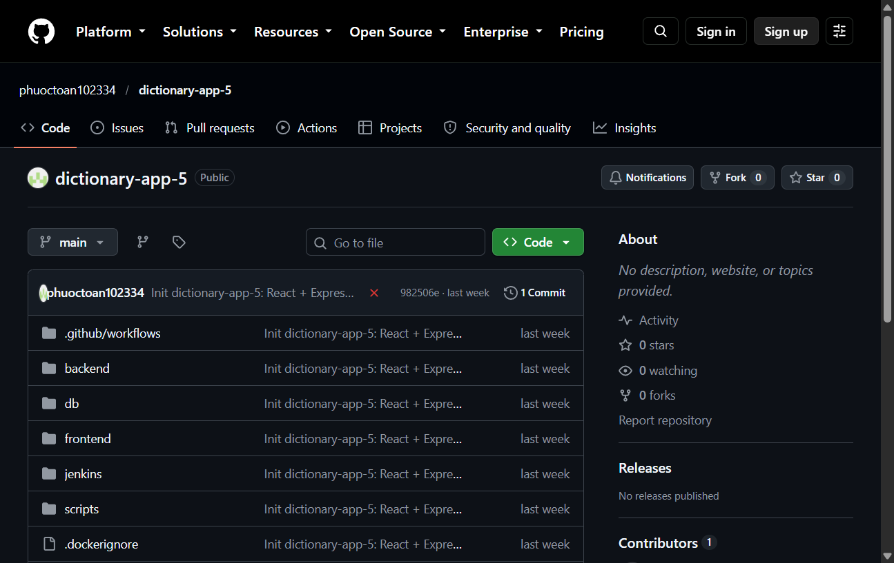
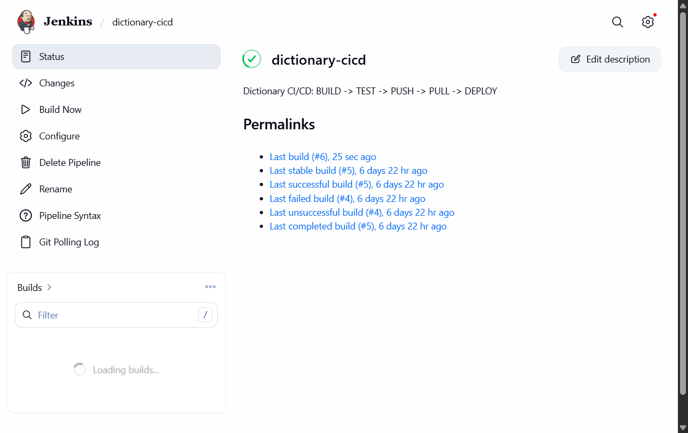
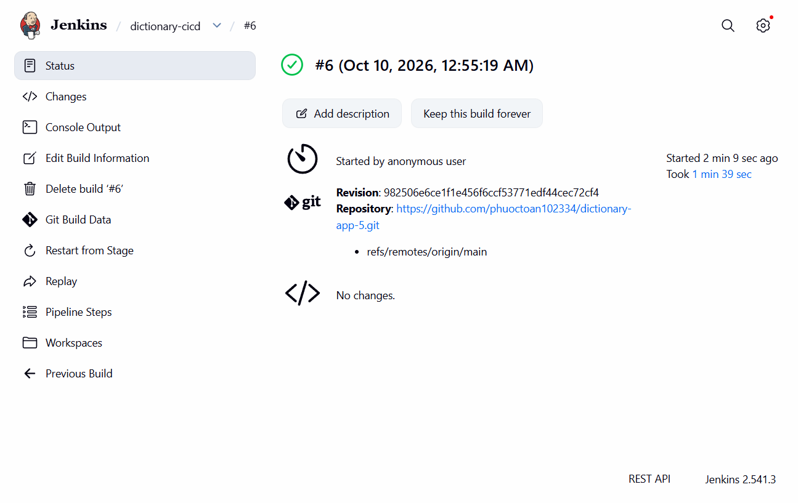
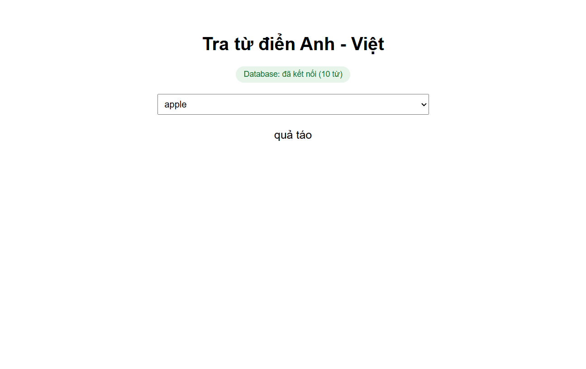
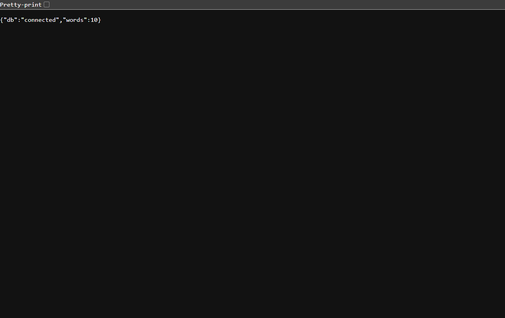

# Student Management System — Quản lý Sinh viên

Ứng dụng quản lý sinh viên (LAB 03): REST API + giao diện web, dữ liệu lưu trên SQL Server.

**Stack:** Java 21 · Spring Boot 3.4.1 · Spring Data JPA · Thymeleaf · SQL Server 2022 · Docker

## Cấu trúc dự án

```
├── backend/     ← API + server Spring Boot (Maven)
├── frontend/    ← index.html (giao diện thuần JS gọi REST API)
├── database/    ← script SQL (database-setup.sql) + Dockerfile SQL Server
├── docker-compose.yml
```

---

## Cách 1: Chạy bằng Docker (khuyên dùng)

**Yêu cầu:** Docker Desktop đã cài và khởi động.

```bash
# Build 3 image + chạy toàn bộ (database, backend, frontend)
docker compose up -d

# Xem trạng thái
docker compose ps

# Dừng (giữ nguyên dữ liệu)
docker compose down

# Dừng và xóa sạch dữ liệu SQL Server
docker compose down -v
```

Sau khi chạy, truy cập:

| Dịch vụ | URL / Port |
|---|---|
| Frontend (giao diện) | http://localhost:3000 |
| Backend (REST API) | http://localhost:8080/api/students |
| SQL Server | localhost:1433 |

- Container `database` tự chạy `database-setup.sql`: tạo database `school`, bảng `students` + dữ liệu mẫu khi khởi động (bỏ qua nếu đã tồn tại).
- Kiểm tra nhanh: mở http://localhost:3000 → bảng sinh viên tự tải; hoặc `curl http://localhost:8080/api/students`.
- Đổi mật khẩu SA: đặt biến môi trường `MSSQL_SA_PASSWORD` trước khi `up` (giá trị mặc định xem trong `docker-compose.yml`); backend tự đọc qua `SPRING_DATASOURCE_*`.

**Chỉ build lại 1 service:** `docker compose build backend` (hoặc `frontend`, `database`), sau đó `docker compose up -d`.

---

## Build project

```bash
# Build backend thành file .jar (từ thư mục backend/)
mvnw.cmd -DskipTests package
# → backend/target/studentmanager-0.0.1-SNAPSHOT.jar

# Chạy file jar (cần cấu hình datasource trước)
java -jar target/studentmanager-0.0.1-SNAPSHOT.jar

# Build toàn bộ image Docker (từ thư mục gốc)
docker compose build
```

**Build trên máy dev này:** máy không có JDK/Maven cài sẵn — dùng JDK tại `c:\oracleJdk-27` và Maven wrapper cache trong `~/.m2/wrapper/dists`, hoặc đơn giản nhất: build bằng Docker (`docker compose build`) không cần JDK local.

---

## REST API

| Method | Endpoint | Mô tả |
|---|---|---|
| GET | `/api/students` | Lấy danh sách sinh viên |
| GET | `/api/students/{id}` | Lấy sinh viên theo ID |
| GET | `/api/students/search?name=...` | Tìm theo tên |
| POST | `/api/students` | Thêm sinh viên (JSON body) |
| POST | `/api/students/update/{id}` | Cập nhật sinh viên |
| POST | `/api/students/delete/{id}` | Xóa sinh viên |

Body mẫu:

```json
{ "id": 4, "name": "Nguyễn Văn D", "age": 21, "email": "d@gmail.com" }
```

---

## Mục 2 — Docker hóa dự án từ điển `giuaky` (tra từ Anh–Việt)

Dự án `giuaky` (React 18 + Vite + Express + Postgres 16) ban đầu thiếu `Dockerfile`
và `docker-compose.yml`. Đã bổ sung đầy đủ để build 1 lần, chạy mọi nơi:

### 2.1. `Dockerfile` (multi-stage)

- **Stage 1 — build frontend:** `node:20-alpine`, `npm ci`, `npm run build` → ra `dist/`.
  Copy `package*.json` trước để tận dụng Docker layer cache.
- **Stage 2 — production:** chỉ cài dependencies backend (`npm ci --omit=dev`),
  copy `dist/` từ stage 1 vào `public/` (Express serve từ đây), chạy `node server.js`.
- Kết quả: image cuối nhẹ, không chứa tool build (vite, eslint...).

### 2.2. `docker-compose.yml` (2 services + named volume)

| Service | Image | Cổng host | Cổng container |
|---|---|---|---|
| `web` | `phuoctoannyx/giuaky:latest` | `8080` (`WEB_PORT`) | `3000` |
| `db` | `phuoctoannyx/giuaky-db:latest` | `55432` (`DB_PORT`) | `5432` |

- `DB_HOST: db` — backend gọi DB bằng tên service (DNS nội bộ Docker), không phải `localhost`.
- `DB_PORT: 5432` trong `web` là cổng **nội bộ**; `55432` chỉ là cổng map ra máy host
  (dùng cho DBeaver/pgAdmin).
- Volume `pgdata:/var/lib/postgresql/data` giữ dữ liệu Postgres khi `down`/`up`;
  `down -v` mới xóa sạch và chạy lại `init.sql` (seed 10 từ).
- `depends_on: db` chỉ đảm bảo thứ tự khởi động container.

### 2.3. Docker Hub (image public, pull về chạy ngay)

- Web: `phuoctoannyx/giuaky:latest` → https://hub.docker.com/r/phuoctoannyx/giuaky
- DB (Postgres 16 + seed data): `phuoctoannyx/giuaky-db:latest`
- `docker-compose.yml` đã chuyển sang dùng image có sẵn thay vì `build`,
  nên người khác chỉ cần 2 file (`docker-compose.yml` + `.env`):

```bash
docker pull phuoctoannyx/giuaky:latest
docker compose up        # không cần source code, không cần build
```

App chạy tại `http://localhost:8080`.

### 2.4. Source code trên GitHub

`git init` → commit → push: https://github.com/phuoctoan102334/giuaky

---

## Phụ lục A — CI/CD dự án dictionary-app-5 bằng Jenkins (làm lại & chụp ảnh ngày 10/10/2026)

Mục này ghi lại **toàn bộ quy trình CI/CD đã thực hiện thật** cho dự án `dictionary-app-5`
(React 18 + Vite + Express + Postgres 16), kiểm chứng lại từ đầu bằng **build Jenkins #6 - SUCCESS**
và chụp ảnh từng bước. Nội dung cũ của README ở trên được giữ nguyên.

### A.1. Tổng quan pipeline

Jenkins chạy trong container trên chính laptop, deploy ngược ra laptop qua `/var/run/docker.sock`.
Pipeline gồm 6 stage:

| Stage | Việc làm |
|---|---|
| Chuẩn bị | Tính tag image theo commit SHA, `docker login` GHCR, tạo builder buildx đa kiến trúc |
| 1. BUILD | Build bản native `linux/amd64` bằng cache trên registry, nạp vào Docker local để test |
| 2. TEST | Chạy `scripts/smoke-test.sh` (8 kiểm tra) trên image vừa build |
| 3. PUSH | Build đa kiến trúc `linux/amd64,linux/arm64`, push tag `:SHA` + `:latest` lên GHCR |
| 4. PULL | Xóa bản local, pull lại từ GHCR để kiểm chứng đúng image đã push |
| 5. DEPLOY | Deploy stack `dictionary-prod` (web `:3000`, db `:5432`), giữ volume dữ liệu |
| 6. Kiểm tra sau deploy | Đợi app phản hồi `/api/health` rồi gọi API thật xác nhận |

Ba nguyên tắc: build một lần cho mỗi kiến trúc (không build lại khi deploy); image đa kiến trúc
(1 tag chạy được cả PC Intel/AMD lẫn Mac M-series); test trên đúng kiến trúc máy mình trước khi push.

### A.2. Chuẩn bị (làm 1 lần)

1. **Docker Desktop** đã cài và khởi động (kiểm tra: `docker version` → Server `29.7.2`, arch `amd64`).
2. **Jenkins container** chạy ở `http://localhost:8080` (thư mục `jenkins/` của dự án dictionary-app-5:
   image Jenkins + mount `/var/run/docker.sock` để điều khiển Docker của laptop).
3. **Repo GitHub public** `phuoctoan102334/dictionary-app-5`, nhánh `main`, đã có `Jenkinsfile`
   (pipeline-as-code), `docker-compose.yml` + `docker-compose.prod.yml`, `scripts/smoke-test.sh`:

   

4. **Token GitHub (classic)** có quyền `write:packages` + `read:packages` → tạo credential
   `ghcr-credentials` (loại Username with password) trong Jenkins. Pipeline đăng nhập bằng
   `--password-stdin` nên token không lộ trong log.
5. **Job `dictionary-cicd`** trỏ về repo trên, nhánh `*/main`, poll SCM 2 phút/lần
   (laptop không có IP public nên GitHub không gọi webhook vào được).

   

### A.3. Chạy lại pipeline từ đầu — build #6 (kết quả thật)

Trigger build qua Jenkins API (`POST /job/dictionary-cicd/build`, kèm crumb + session),
sau đó theo dõi đến khi xong. Dashboard Jenkins lúc build đang chạy:


Trang chủ job `dictionary-cicd` (mô tả pipeline, lịch sử #5 SUCCESS / #4 FAILURE từ lần làm trước):



**Kết quả build #6: SUCCESS** — revision `982506e`, `Took 1 min 39 sec`:



Chi tiết từng stage (trích console log build #6):

- **Chuẩn bị:** `Image: ghcr.io/phuoctoan102334/dictionary-app-5:982506e`,
  máy `linux/amd64`, sẽ push `linux/amd64,linux/arm64`; `docker login ghcr.io` thành công.
- **1. BUILD:** `docker buildx build --platform linux/amd64 --tag ...:982506e
  --cache-from ...:buildcache --cache-to ...:buildcache --load .`
- **2. TEST:** 8/8 PASS —
  `health báo đã kết nối DB`, `health đúng 10 từ`, `danh sách từ có 'computer'`,
  `tra 'computer' ra nghĩa tiếng Việt`, `tra chữ hoa 'APPLE' vẫn ra kết quả`,
  `từ không tồn tại trả HTTP 404`, `trang chủ trả HTTP 200`, `database có bảng words`.
- **3. PUSH:** build `linux/amd64,linux/arm64`, push 2 tag `:982506e` + `:latest`
  lên `ghcr.io` (package để chế độ **private** nên trang Packages public không hiện —
  bằng chứng là digest ở stage PULL bên dưới).
- **4. PULL:** `docker pull ghcr.io/phuoctoan102334/dictionary-app-5:982506e` →
  `Digest: sha256:1be5aa4d354cc1c64f76a8363cd3f9667d0f968077232dc88dc49013f02e779`.
- **5. DEPLOY:** `docker compose -p dictionary-prod -f docker-compose.yml
  -f docker-compose.prod.yml up -d` → `dictionary-prod-web-1 Running`,
  `dictionary-prod-db-1 Healthy` (volume dữ liệu được giữ, không `down -v`).
- **6. Kiểm tra sau deploy:** `App sẵn sàng sau 1s`, gọi thật `/api/health` và
  `/api/define/computer` đều trả kết quả → `THÀNH CÔNG, Ứng dụng: http://localhost:3000`.

Ứng dụng sau deploy (tra từ `apple` → `quả táo`, Database đã kết nối 10 từ):





### A.4. Sự cố đã gặp và cách xử lý (lần làm đầu, build #1–#5)

| Sự cố | Cách xử lý |
|---|---|
| Port `:3000` bị `multica-frontend-1` chiếm, port `:8080` bị `multica-backend-1` chiếm | Được chủ máy đồng ý → stop container multica, chạy stack dict ở port thay thế lúc thử nghiệm |
| DNS chập chờn (AdGuard `94.140.14.14`): build #1 rớt ở `docker login`, #2 rớt ở `auth.docker.io`, #3 rớt ở `registry-1.docker.io`, #4 rớt ở `imagetools inspect ghcr.io` | Không đổi được DNS (máy không có quyền admin) → chạy lại build đến khi mạng ổn; build #5 SUCCESS toàn pipeline |
| Lần ghi tài liệu này (10/10): Docker Desktop chưa khởi động, Brave CDP chưa bật | Khởi động Docker Desktop, mở Brave profile riêng với `--remote-debugging-port=9222` (không đụng phiên Brave của người dùng) |
| Jenkins API báo `403 No valid crumb` khi trigger build | Crumb phải đi kèm session cookie → dùng `WebRequestSession`: GET crumb rồi POST kèm header `Jenkins-Crumb` trong cùng session |
| GHCR package 401 khi xem ẩn danh / `gh` thiếu scope `read:packages` | Package đang ở chế độ private — kiểm chứng bằng digest lúc PULL trong console log thay vì xem web |

Lưu ý bảo mật: Jenkins local hiện chạy chế độ mở (Unsecured, không cần đăng nhập —
build #6 hiển thị `Started by anonymous user`). Ổn cho lab trên laptop cá nhân;
nếu expose Jenkins ra mạng ngoài thì phải bật authentication + authorization.

### A.5. Rollback về bản trước (thay `<sha_cũ>`)

```bash
IMAGE_TAG=ghcr.io/phuoctoan102334/dictionary-app-5:<sha_cũ> WEB_PORT=3000 DB_PORT=5432 \
POSTGRES_USER=dictuser POSTGRES_PASSWORD=dictpass POSTGRES_DB=dictionary \
docker compose -p dictionary-prod \
  -f docker-compose.yml -f docker-compose.prod.yml up -d
```

### A.6. Danh mục ảnh (`image_toan/`)

| File | Nội dung |
|---|---|
| `01-jenkins-dashboard.png` | Dashboard Jenkins, build #6 đang chạy stage Chuẩn bị |
| `02-jenkins-job-dictionary-cicd.png` | Trang chủ job, lịch sử build #5 SUCCESS / #4 FAILURE |
| `03-github-repo-dictionary-app-5.png` | Repo GitHub public, nhánh `main` |
| `04-app-dictionary-chay-o-cong-3000.png` | App tra từ điển sau deploy |
| `05-api-health-connected-10-tu.png` | API `/api/health` trả `connected`, 10 từ |
| `06-jenkins-build-6-thanh-cong.png` | Build #6 SUCCESS, revision `982506e` |
| `07-jenkinsfile-tren-github.png` | File `Jenkinsfile` (pipeline-as-code) trên GitHub |
