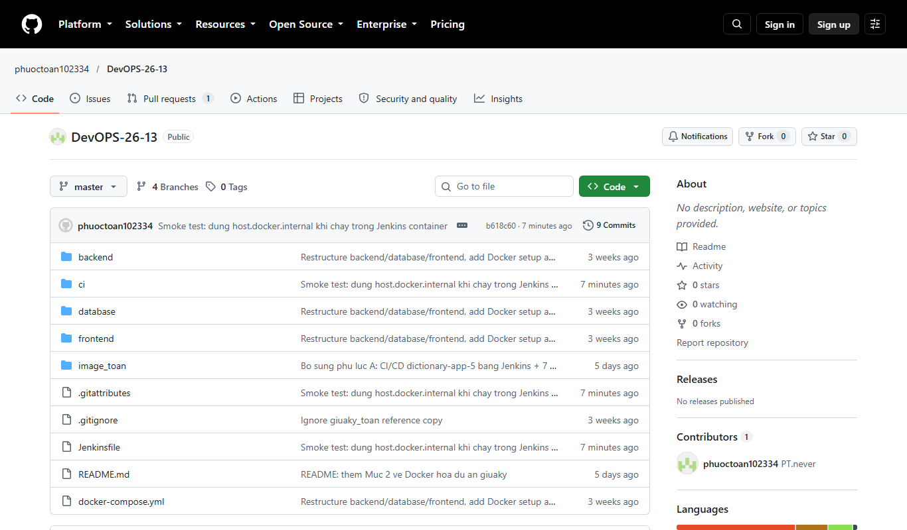
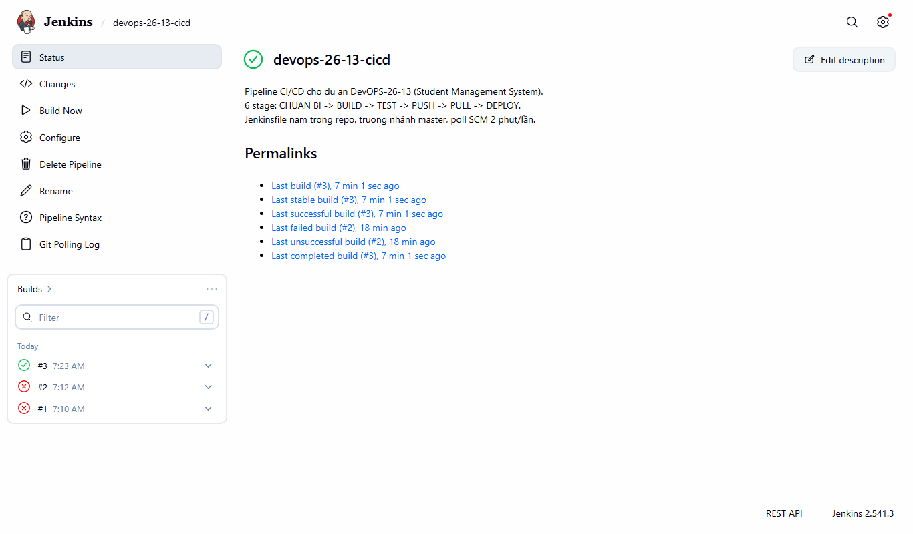
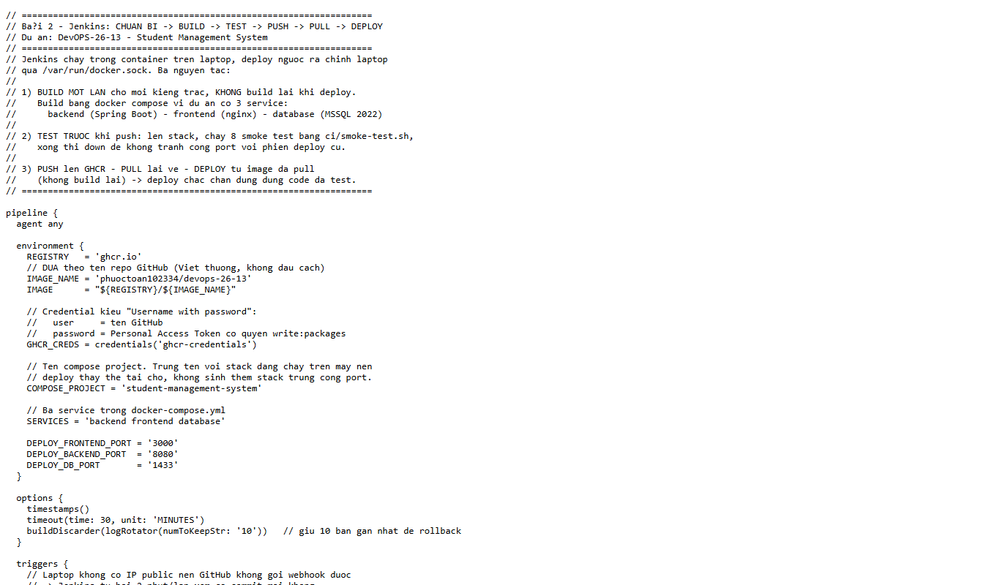
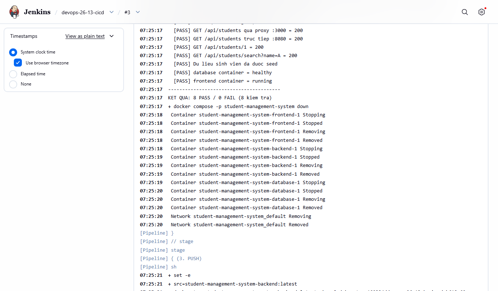
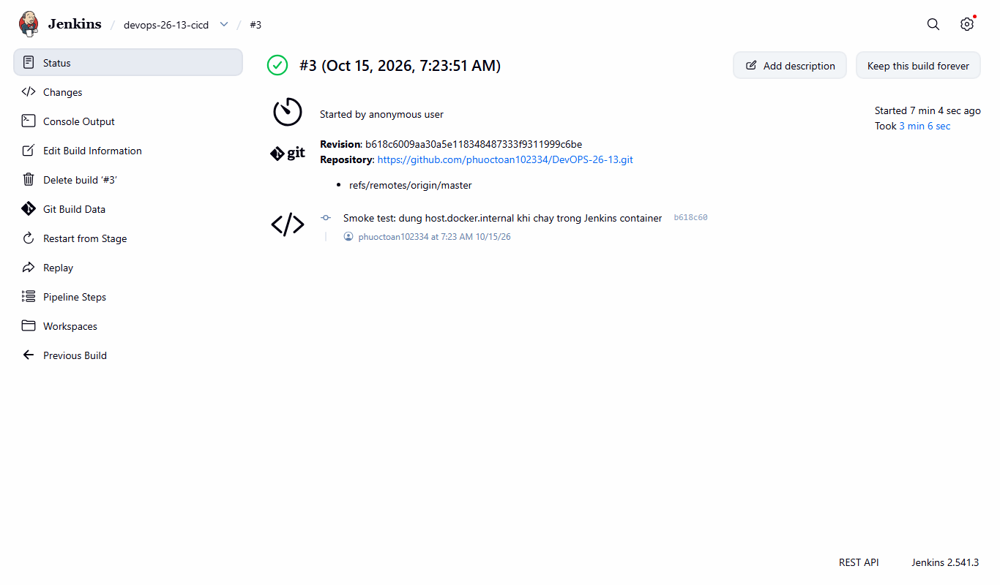
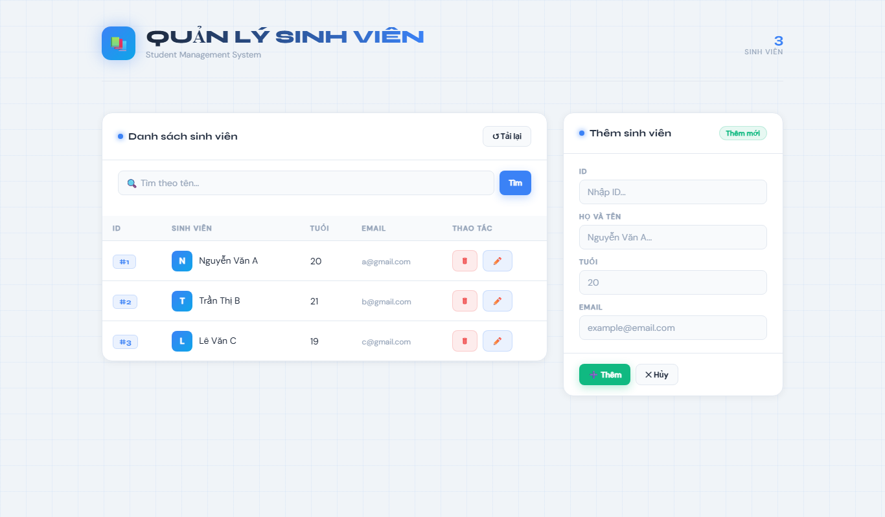
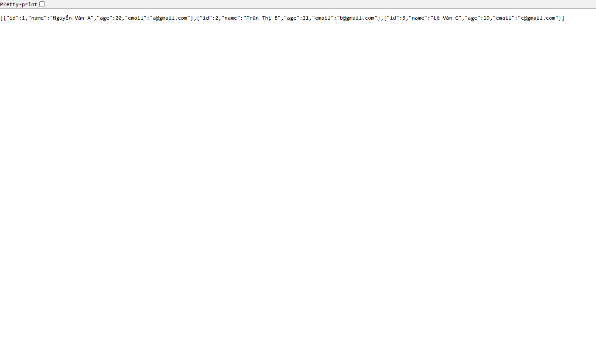
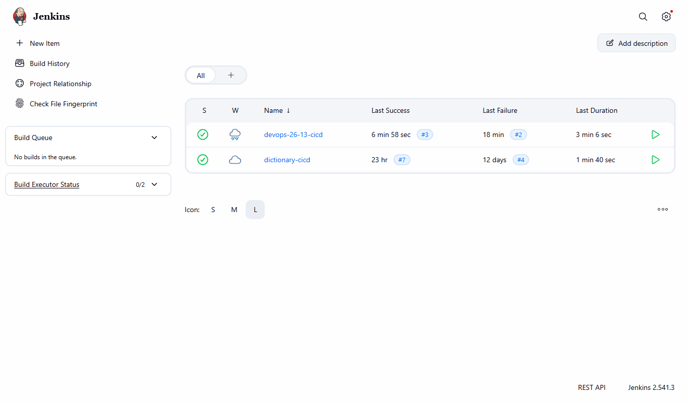

# Student Management System — Quản lý Sinh viên

Ứng dụng quản lý sinh viên (LAB 03): REST API + giao diện web, dữ liệu lưu trên SQL Server.

**Stack:** Java 21 · Spring Boot 3.4.1 · Spring Data JPA · Thymeleaf · SQL Server 2022 · Docker

## Cấu trúc dự án

```
├── backend/     ← API + server Spring Boot (Maven)
├── frontend/    ← index.html (giao diện thuần JS gọi REST API)
├── database/    ← script SQL (database-setup.sql) + Dockerfile SQL Server
├── docker-compose.yml
```

---

## Cách 1: Chạy bằng Docker (khuyên dùng)

**Yêu cầu:** Docker Desktop đã cài và khởi động.

```bash
# Build 3 image + chạy toàn bộ (database, backend, frontend)
docker compose up -d

# Xem trạng thái
docker compose ps

# Dừng (giữ nguyên dữ liệu)
docker compose down

# Dừng và xóa sạch dữ liệu SQL Server
docker compose down -v
```

Sau khi chạy, truy cập:

| Dịch vụ | URL / Port |
|---|---|
| Frontend (giao diện) | http://localhost:3000 |
| Backend (REST API) | http://localhost:8080/api/students |
| SQL Server | localhost:1433 |

- Container `database` tự chạy `database-setup.sql`: tạo database `school`, bảng `students` + dữ liệu mẫu khi khởi động (bỏ qua nếu đã tồn tại).
- Kiểm tra nhanh: mở http://localhost:3000 → bảng sinh viên tự tải; hoặc `curl http://localhost:8080/api/students`.
- Đổi mật khẩu SA: đặt biến môi trường `MSSQL_SA_PASSWORD` trước khi `up` (giá trị mặc định xem trong `docker-compose.yml`); backend tự đọc qua `SPRING_DATASOURCE_*`.

**Chỉ build lại 1 service:** `docker compose build backend` (hoặc `frontend`, `database`), sau đó `docker compose up -d`.

---

## Build project

```bash
# Build backend thành file .jar (từ thư mục backend/)
mvnw.cmd -DskipTests package
# → backend/target/studentmanager-0.0.1-SNAPSHOT.jar

# Chạy file jar (cần cấu hình datasource trước)
java -jar target/studentmanager-0.0.1-SNAPSHOT.jar

# Build toàn bộ image Docker (từ thư mục gốc)
docker compose build
```

**Build trên máy dev này:** máy không có JDK/Maven cài sẵn — dùng JDK tại `c:\oracleJdk-27` và Maven wrapper cache trong `~/.m2/wrapper/dists`, hoặc đơn giản nhất: build bằng Docker (`docker compose build`) không cần JDK local.

---

## REST API

| Method | Endpoint | Mô tả |
|---|---|---|
| GET | `/api/students` | Lấy danh sách sinh viên |
| GET | `/api/students/{id}` | Lấy sinh viên theo ID |
| GET | `/api/students/search?name=...` | Tìm theo tên |
| POST | `/api/students` | Thêm sinh viên (JSON body) |
| POST | `/api/students/update/{id}` | Cập nhật sinh viên |
| POST | `/api/students/delete/{id}` | Xóa sinh viên |

Body mẫu:

```json
{ "id": 4, "name": "Nguyễn Văn D", "age": 21, "email": "d@gmail.com" }
```

---

## Mục 2 — Docker hóa dự án từ điển `giuaky` (tra từ Anh–Việt)

Dự án `giuaky` (React 18 + Vite + Express + Postgres 16) ban đầu thiếu `Dockerfile`
và `docker-compose.yml`. Đã bổ sung đầy đủ để build 1 lần, chạy mọi nơi:

### 2.1. `Dockerfile` (multi-stage)

- **Stage 1 — build frontend:** `node:20-alpine`, `npm ci`, `npm run build` → ra `dist/`.
  Copy `package*.json` trước để tận dụng Docker layer cache.
- **Stage 2 — production:** chỉ cài dependencies backend (`npm ci --omit=dev`),
  copy `dist/` từ stage 1 vào `public/` (Express serve từ đây), chạy `node server.js`.
- Kết quả: image cuối nhẹ, không chứa tool build (vite, eslint...).

### 2.2. `docker-compose.yml` (2 services + named volume)

| Service | Image | Cổng host | Cổng container |
|---|---|---|---|
| `web` | `phuoctoannyx/giuaky:latest` | `8080` (`WEB_PORT`) | `3000` |
| `db` | `phuoctoannyx/giuaky-db:latest` | `55432` (`DB_PORT`) | `5432` |

- `DB_HOST: db` — backend gọi DB bằng tên service (DNS nội bộ Docker), không phải `localhost`.
- `DB_PORT: 5432` trong `web` là cổng **nội bộ**; `55432` chỉ là cổng map ra máy host
  (dùng cho DBeaver/pgAdmin).
- Volume `pgdata:/var/lib/postgresql/data` giữ dữ liệu Postgres khi `down`/`up`;
  `down -v` mới xóa sạch và chạy lại `init.sql` (seed 10 từ).
- `depends_on: db` chỉ đảm bảo thứ tự khởi động container.

### 2.3. Docker Hub (image public, pull về chạy ngay)

- Web: `phuoctoannyx/giuaky:latest` → https://hub.docker.com/r/phuoctoannyx/giuaky
- DB (Postgres 16 + seed data): `phuoctoannyx/giuaky-db:latest`
- `docker-compose.yml` đã chuyển sang dùng image có sẵn thay vì `build`,
  nên người khác chỉ cần 2 file (`docker-compose.yml` + `.env`):

```bash
docker pull phuoctoannyx/giuaky:latest
docker compose up        # không cần source code, không cần build
```

App chạy tại `http://localhost:8080`.

### 2.4. Source code trên GitHub

`git init` → commit → push: https://github.com/phuoctoan102334/giuaky
---

## Phụ lục A — CI/CD dự án DevOPS-26-13 bằng Jenkins (build #3, 15/10/2026)

Mục này ghi lại **toàn bộ quy trình CI/CD đã thực hiện thật** cho repo môn học
`DevOPS-26-13` — ứng dụng quản lý sinh viên gồm `backend` (Spring Boot 3.4.1 / Java 21),
`frontend` (nginx) và `database` (SQL Server 2022), điều phối bằng `docker-compose.yml`.
Kết quả nghiệm thu là **build Jenkins #3 — SUCCESS** (15/10/2026, 3 phút 06 giây),
ảnh chụp từng bước nằm trong `image_toan/`.

### A.1. Tổng quan pipeline

| Stage | Nội dung |
|---|---|
| Checkout SCM | Lấy `Jenkinsfile` từ nhánh `master` của repo |
| Chuẩn bị | Tính tag theo commit, kiểm tra Docker Compose, `docker login ghcr.io` |
| 1. BUILD | `docker compose -p student-management-system build` → 3 image |
| 2. TEST | Lên stack tạm → chạy `ci/smoke-test.sh` (8 kiểm tra) → hạ stack |
| 3. PUSH | Đổi tên và push 6 tag (3 image × `:b618c60` và `:latest`) lên GHCR |
| 4. PULL | Pull lại đúng image vừa push, đối chiếu Digest, đổi tên về tag compose cần |
| 5. DEPLOY | `up -d --no-build` → chạy lại 8 smoke test → báo kết quả ở `post` |

Mã nguồn pipeline: [`Jenkinsfile`](Jenkinsfile) ·
kiểm thử: [`ci/smoke-test.sh`](ci/smoke-test.sh)



### A.2. Chuẩn bị (làm 1 lần)

1. **Jenkins container** tại `http://localhost:8090` — cố ý rời khỏi 8080 để nhường
   cổng đó cho backend theo `docker-compose.yml`. Volume `jenkins_jenkins_home` được giữ
   nguyên nên job và credential không mất.

   ```powershell
   docker run -d --name jenkins --restart unless-stopped --network jenkins_default `
     --group-add 0 -p 8090:8080 -p 50000:50000 `
     -e "JAVA_OPTS=-Djenkins.install.runSetupWizard=false" `
     -v jenkins_jenkins_home:/var/jenkins_home `
     -v /run/host-services/docker.proxy.sock:/var/run/docker.sock `
     jenkins-jenkins
   ```
   `--group-add 0` là bắt buộc: socket Docker ở chế độ `660 root:root`, còn user
   `jenkins` là uid 1000 nên không có quyền ghi nếu thiếu nhóm phụ này.

2. **Credential** id `ghcr-credentials` (kiểu *Username with password*: user = tên GitHub,
   password = Personal Access Token có quyền `write:packages`). Pipeline gọi bằng
   `credentials('ghcr-credentials')`.

3. **Job `devops-26-13-cicd`** — kiểu *Pipeline script from SCM*: repo
   `https://github.com/phuoctoan102334/DevOPS-26-13.git`, nhánh `*/master`,
   `Jenkinsfile` ở thư mục gốc, trigger `H/2 * * * *`.

   

4. **`Jenkinsfile` + `ci/smoke-test.sh`** đã commit và push lên `master`
   (commit `8dda4a8` rồi `b618c60`).

   

### A.3. Chạy pipeline — build #3 — SUCCESS

Trigger build qua Jenkins API (`POST /job/devops-26-13-cicd/build`, crumb kèm
session cookie). Khi chạy xong, `post` in ra:

```
DEPLOY THANH CONG - ghcr.io/phuoctoan102334/devops-26-13:b618c60 tai http://localhost:3000
```

| Mục | Giá trị |
|---|---|
| Job / Build | `devops-26-13-cicd` / **#3** |
| Thời điểm | 14:23:52, ngày 15/10/2026 (giờ +07) |
| Thời gian chạy | **3 phút 06 giây** |
| Trạng thái | SUCCESS (dấu tích xanh) |
| Revision | `b618c6009aa30a5e118348487333f9311999c6be` |
| Commit | “Smoke test: dung host.docker.internal khi chay trong Jenkins container” |
| Image và digest | `…-backend` `d99a5eaaf076…`, `…-frontend` `62449a8c681f…`, `…-database` `b01a64981051…` |

Kết quả chi tiết:

- **1. BUILD** — 3 image: `backend` 504MB, `database` 2.35GB, `frontend` 73.6MB.
- **2. TEST — 8/8 PASS**: trang chủ 200 · API qua proxy 200 · API trực tiếp 200 ·
  `GET /api/students/1` 200 · `GET /api/students/search?name=A` 200 · dữ liệu seed đã nạp ·
  `database` container healthy · `frontend` container running.
- **3. PUSH** — push 6 tag (3 image × `:b618c60` + `:latest`) lên GHCR.
- **4. PULL** — Digest của 3 image khớp hoàn toàn với Digest vừa push.
- **5. DEPLOY** — `docker compose up -d --no-build`, chạy lại 8 smoke test → 8/8 PASS.





Ứng dụng sau deploy:





### A.4. Sự cố đã gặp và cách xử lý (build #1–#2)

| # | Lỗi | Nguyên nhân | Cách xử lý |
|---|---|---|---|
| 1 | `exec /opt/mssql-init/entrypoint-init.sh: no such file or directory` | `core.autocrlf=true` khiến file `.sh` trong working tree có CRLF | Thêm `*.sh`, `*.conf`, `Dockerfile`, `*.yml`, `Jenkinsfile` vào `.gitattributes` với `text eol=lf` rồi checkout lại |
| 2 | `permission denied … unix:///var/run/docker.sock` (build #1) | Socket `660 root:root`, user `jenkins` uid 1000 không thuộc nhóm root | Tạo lại container với `--group-add 0`, kiểm tra bằng `docker version` chạy trong container |
| 3 | Smoke test `000000` / `404` (build #2) | `localhost` bên trong container Jenkins là chính Jenkins (cũng nghe 8080) | Dùng `host.docker.internal`; `ci/smoke-test.sh` tự nhận diện môi trường (`/.dockerenv` + `getent hosts`) |
| 4 | `403 No valid crumb` khi gọi API Jenkins | Crumb phải đi kèm session cookie | GET crumb rồi POST build trong cùng `WebRequestSession` / cùng cookie jar |

Lịch sử build: **#1 FAILURE** (18s) → **#2 FAILURE** (6 phút 53 giây) → **#3 SUCCESS** (3 phút 06 giây).



### A.5. Rollback về bản trước

```bash
# Lấy sha cần quay lại
SHA=$(git rev-parse --short=7 HEAD~1)
git revert <commit> && git push origin master
# hoặc chạy lại job với commit cũ:
curl -X POST -H "Jenkins-Crumb:<crumb>" \
  "http://localhost:8090/job/devops-26-13-cicd/build?delay=0sec"
```

Image đã push lên GHCR luôn gắn với tag `:<sha>` nên có thể deploy lại bản cũ bằng
`IMAGE_TAG=<sha>` mà không cần build lại.

### A.6. Danh mục ảnh (`image_toan/`)

| Tệp | Nội dung |
|---|---|
| `hinh-41-wsl-ubuntu.png` | WSL, phiên làm việc Ubuntu |
| `hinh-42-ubuntu-he-thong.png` | Ngày giờ, mạng, ổ đĩa, bộ nhớ của Ubuntu |
| `hinh-43-ssh-thanh-cong.png` | SSH từ Ubuntu vào Windows thành công |
| `hinh-45-docker-pull-run.png` | `docker pull alpine`, chạy container `toan` |
| `hinh-46-docker-exec-tao-file.png` | `docker exec`, tạo và đọc file `hello.txt` |
| `01-jenkins-dashboard.png` | Dashboard Jenkins tại cổng 8090 |
| `02-jenkins-job-devops-26-13.png` | Trang job, lịch sử build #1–#3 |
| `03-github-repo-devops-26-13.png` | Repo GitHub public, nhánh `master` |
| `04-app-sinh-vien-o-cong-3000.png` | Ứng dụng quản lý sinh viên sau deploy |
| `05-api-students-json.png` | API `/api/students` trả JSON danh sách |
| `06-jenkins-build-3-thanh-cong.png` | Build #3 SUCCESS, revision `b618c60` |
| `07-jenkinsfile-tren-github.png` | File `Jenkinsfile` (pipeline-as-code) trên GitHub |
| `08-jenkins-smoke-test-8-8.png` | Console log: `KET QUA: 8 PASS / 0 FAIL` |
