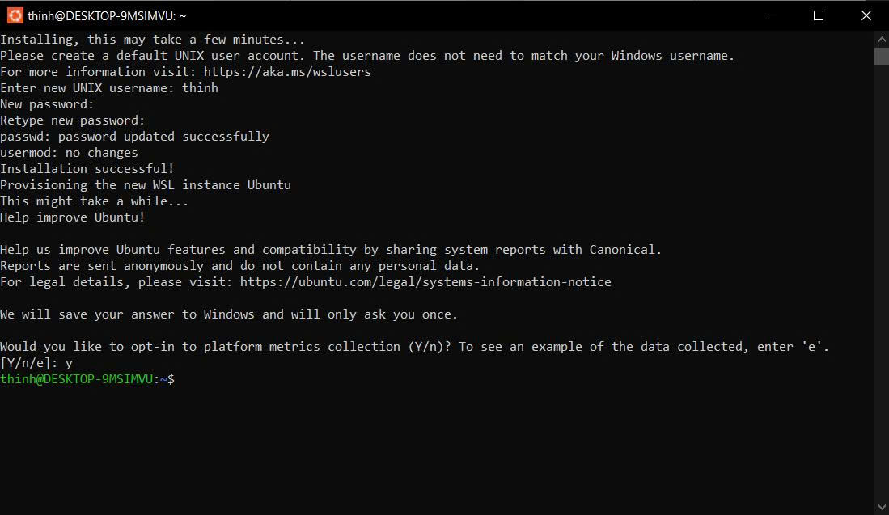
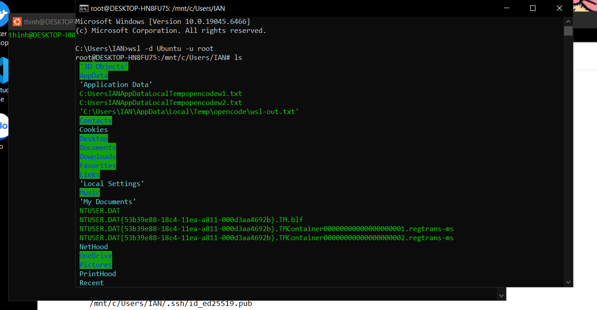
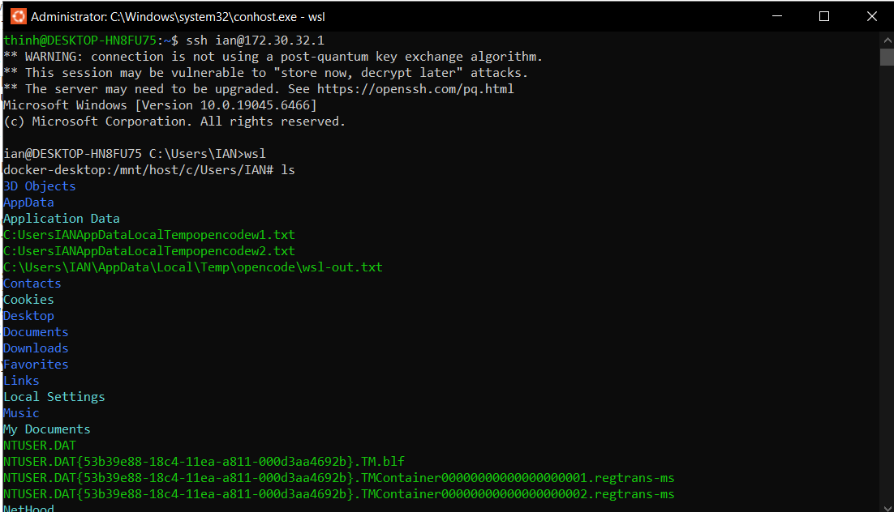
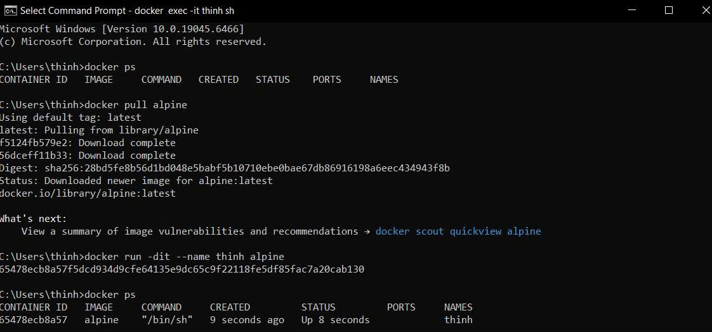
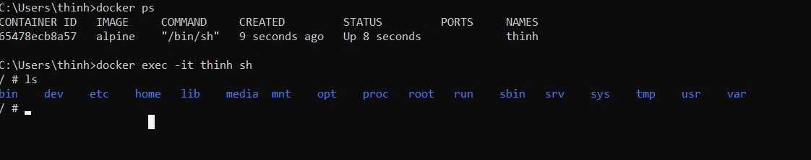
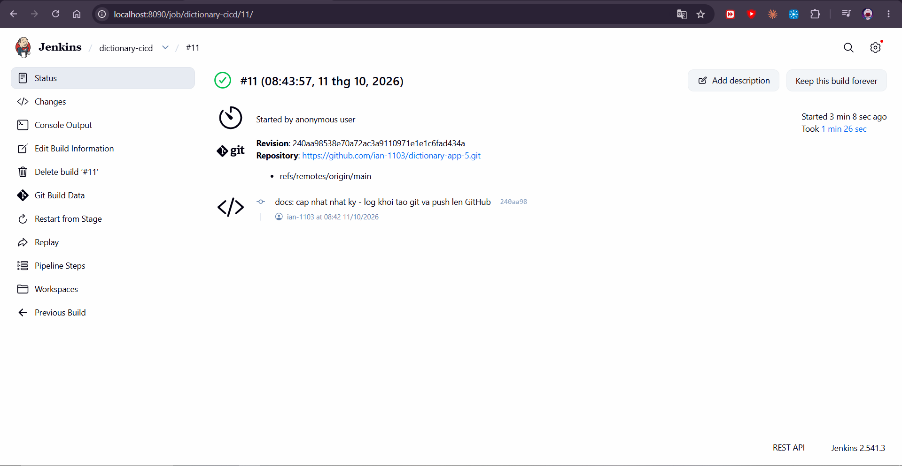

| **Sinh viên thực hiện** | Trần Thanh Thịnh — 102688 — IT23M |
| **Địa điểm, thời gian** | Đắk Lắk, 10/2026 |

---

## 1. Cài unbuntu

**A.**

**B.**

## 2. Ssh từ unbuntu vào win

## 3. Sài lệnh và tạo file

**A.**

**B.**

## 4. Viết Jenkins cho dự án

---

*Thứ tự nội dung và ảnh lấy theo `image_thinh`. Ảnh nằm trong `image_thinh/`.*
